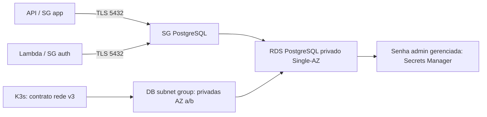

# Oficina — RDS PostgreSQL, Fase 3

**Grupo 97** · **Pedro Paulo dos Santos Silva** · Discord **pedropaulo6447**.
Terraform independente para RDS, DB subnet group e SG PostgreSQL; rede/compute
pertencem ao repo K3s. [Entrega consolidada](https://github.com/ppdssdev/tech-challenge-oficina/blob/main/docs/fase3/README.md) ·
[evidências deste repo](docs/fase3-evidence.md).

## Estado, stack e diagrama

Auditoria 2026-11-03: RDS available, PostgreSQL **16.15**, **db.t4g.micro**, privado,
criptografado e **Single-AZ**, banco oficina_db, backup automático configurado para
1 dia, deletion protection ativa e subnet group em duas AZs. Porta 5432 aceita
somente os SGs app/auth. Nenhuma sessão SQL remota ou restore foi executado.
Produção não demonstrada; duas subnets não criam HA do banco.

Terraform 1.14.6/provider AWS 6.38.0, PostgreSQL 16, 20 GiB gp3 sem autoscaling de
storage configurado. [rds.tf](rds.tf) valida oferta regional/minor e não faz fallback
silencioso para classe mais cara. Credencial administrativa gerenciada pelo RDS;
usuários mínimos runtime são responsabilidade da API/bootstrap SQL.



[Arquitetura e contrato](docs/architecture.md), [ADR RDS privado](docs/adr/0001-rds-privado.md),
[MER real V1–V11](https://github.com/ppdssdev/tech-challenge-oficina/blob/main/docs/fase3/data-model.md)
e [justificativa SQL](https://github.com/ppdssdev/tech-challenge-oficina/blob/main/docs/fase3/database-design.md).
Migrations não são duplicadas aqui. Não há Swagger; a interface é [outputs.tf](outputs.tf).

## Contrato e segurança

Recebe network_contract v3 com conta/região/ambiente, VPC, duas ou mais subnets em
AZs distintas e SGs app/auth distintos. Data sources/preconditions conferem IDs,
owner, VPC e atribuição pública; não auditam integralmente rotas/NACLs. O produtor
K3s mantém essas rotas. [network.tf](network.tf) permite entrada somente por SGs,
sem CIDR de clientes. Clientes precisam TLS verify-full/CA e credenciais próprias.

Outputs: rds_identifier, db_endpoint, db_port, db_name e db_security_group_id.
admin_secret_arn é separado e administrativo: não usar no contrato/runtime Lambda.
Não consultar SecretString nem publicar senha/tfstate/plan em documentação.
Endpoint Secrets Manager para aplicações pertence à stack K3s, não ao RDS.

## Execução, testes e CI/CD

Requisitos: Terraform 1.14.6, Python com Checkov 3.2.471 e bc-python-hcl2 0.4.3.
Validação local estática, sem backend e sem recursos AWS:

```bash
terraform fmt -check -recursive
terraform init -backend=false -input=false
terraform validate
python3 -m venv .venv
. .venv/bin/activate
pip install checkov==3.2.471 bc-python-hcl2==0.4.3
python scripts/bootstrap_policy.py
checkov --directory . --framework terraform --compact --skip-download   --skip-path .venv --skip-path .terraform
git diff --check
```

[Workflow CI](.github/workflows/ci.yml) reproduz essas verificações; exceções Checkov
estão justificadas junto ao recurso RDS (Single-AZ/monitoramento/logs/IAM DB auth).
[Run main auditado](https://github.com/ppdssdev/tech-challenge-oficina-infra-rds/actions/runs/41625940842)
concluiu success. Não há teste de conectividade/restore implícito em terraform validate.
[PR OIDC #7](https://github.com/ppdssdev/tech-challenge-oficina-infra-rds/pull/7)
permanece preparatória; sem CD AWS em main e auditoria provider bloqueada pela SCP.

## Deploy e backend

Rede K3s precede RDS; auth/API consomem os outputs e aplicam SQL sob credencial
migrator separada. Para provisionamento, revisar contrato real/conta/região, oferta,
variáveis, orçamento e plan conforme [arquitetura](docs/architecture.md). Esta PR
não executa init de backend, plan remoto, apply ou migração SQL em RDS.

[backend.tf](backend.tf) define S3 staging/rds, use_lockfile e encrypt;
[MIGRACAO-BACKEND.md](MIGRACAO-BACKEND.md) contém procedimento. Configuração no Git
não comprova migração efetiva nem controles do bucket; state não foi inspecionado.
Não inicializar backend compartilhado para gerar diagramas.

## Backups, rollback e custos

Configuração: backup diário 03:00–04:00 UTC, manutenção domingo 05:00–06:00 UTC,
apply_immediately=false, delete_automated_backups=false e skip_final_snapshot=false.
Retenção 1 dia é valor atual, não promessa de elegibilidade/gratuidade. Deletion
protection exige etapa específica antes de eventual destruição; snapshot final
precisa nome único e política de retenção. Nenhuma desmontagem foi realizada.

Restore deve ser ensaiado em destino separado, com conectividade, credenciais,
integridade e tempo medidos; RPO/RTO permanecem pendentes. Rollback de API não
reverte schema; restaurar banco não é substituir silenciosamente o recurso em uso.
Principais custos: instância, storage gp3, snapshots/backups excedentes, Secrets
Manager, requests e tráfego; snapshots podem custar após remoção do banco. Sem
estimativa atual/fatura auditada nesta entrega. Single-AZ reduz escopo/custo, mas
não oferece failover entre AZs.

[API/Flyway](https://github.com/ppdssdev/tech-challenge-oficina) ·
[K3s/rede](https://github.com/ppdssdev/tech-challenge-oficina-infra-k3s) ·
[Lambda auth](https://github.com/ppdssdev/tech-challenge-oficina-auth-lambda).
Relatórios de bootstrap são históricos; estado vigente e pendências estão na matriz central.
