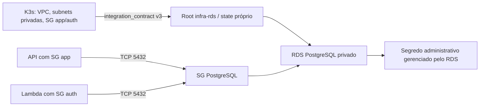

> **Leitura atualizada em 2026-11-03:** este runbook conserva o contexto da sua
> preparação original. A existência de recursos cloud e o CI atual estão em
> [evidências consolidadas](fase3-evidence.md); itens não observados continuam pendentes.
> Backend S3 já está definido em código; não interpretar menções históricas a backend
> local ou “nenhum recurso provisionado nesta etapa” como estado atual do ambiente.

# Arquitetura RDS independente

Fonte consultada: `../tech-challenge-oficina-infra-k3s/outputs.tf` e
`../tech-challenge-oficina-infra-k3s/docs/stack-contract.md` (v3).

| Objeto | Dono |
|---|---|
| VPC, subnets, rotas, EC2/K3s, ECR, IAM, SG app/auth e suas saídas | infra-k3s |
| RDS, DB subnet group, SG PostgreSQL, dois ingressos 5432 | infra-rds |
| Lambda, associação SG auth/ENIs, acesso ao segredo da aplicação | stack auth |
| Migrations, usuários SQL e privilégios | aplicações |

Não há leitura de RDS pelo K3s nem referência inversa a outputs RDS no produtor.
Ordem futura: rede K3s → RDS → aplicações/auth. Desmontar dependências antes da rede.

## Interface e bloqueios

`network_contract` é objeto tipado com `schema_version: number`, `account_id`,
`region`, `environment`, `vpc_id`, `app_security_group_id`,
`auth_security_group_id` (strings) e `private_subnet_ids: list(string)`.
Não aceita o antigo metadado `implemented=false` como contrato.

Validações de variável rejeitam versão diferente de 3, conta/região/ambiente
incompatíveis, IDs inválidos, subnets duplicadas ou menos de duas, SGs iguais e
major PostgreSQL diferente de 16. O provider restringe a conta por
`allowed_account_ids`, região Ohio e perfil oficina-staging.

Data sources consultam IDs específicos na região configurada. Preconditions do
subnet group bloqueiam conta/VPC incorretas, subnets com IP público automático,
menos de duas AZs distintas e SGs fora da conta/VPC. Todos os recursos dependem
diretamente ou transitivamente desse ponto de validação. Não há check blocks.
Oferta RDS e minor são verificadas por data sources; indisponibilidade falha sem
fallback de custo. A oferta comercial não garante capacidade instantânea de criação.

A propriedade privada/isolada das rotas é mantida pelo K3s; esta stack verifica
VPC/AZ/owner e map_public_ip_on_launch, mas não faz auditoria completa das route tables.
Mesmo se rotas mudarem, RDS continua sem endpoint público e o SG só aceita os dois
SGs referenciados. Revisar também a rede produtora antes da implantação.

## Compatibilidade Java e Lambda

O banco inicial e o output `db_name` são `oficina_db`; `db_port` é 5432.
O output referencia `aws_db_instance.postgres.db_name`, evitando uma constante
de saída que possa divergir do banco criado. O identificador da instância continua
`oficina-staging-postgres` e o usuário administrativo continua `oficina_admin`.

| Consumidor | Mapeamento |
|---|---|
| API Java | `SPRING_DATASOURCE_URL=jdbc:postgresql://<db_endpoint>:5432/oficina_db?sslmode=verify-full`; CA RDS confiável no cliente |
| Lambda auth | `rds_contract` contém `rds_identifier`, `db_endpoint`, `db_port`, `db_name` e `db_security_group_id`; a stack deriva `DB_HOST`, `DB_PORT` e `DB_NAME` |
| Rede K3s | `network_contract` recebe integralmente `integration_contract` v3; nome de banco não faz parte desse contrato |

Conferência estática nos checkouts irmãos:

- Java: `../tech-challenge-oficina/src/main/resources/application-local.yml`
  já usa `oficina_db`; `application-staging.yml` recebe a URL por ambiente,
  mantém Hibernate em `validate` e Flyway desabilitado no runtime de staging.
- Lambda: `../tech-challenge-oficina-auth-lambda/infra/terraform/variables.tf`
  exige `oficina_db`/5432 e os cinco outputs acima; `main.tf` repassa as variáveis
  e confere o nome no data source RDS em uma operação futura autorizada.
  `auth/cloud.py` também exige esse banco/porta e monta a conexão com
  `sslmode=verify-full`, CA confiável e usuário de aplicação `oficina_lambda`.
- K3s: `../tech-challenge-oficina-infra-k3s/outputs.tf` publica os oito campos
  tipados de v3, incluindo os SGs app/auth e duas subnets privadas. Ambos os
  consumidores aceitam esse formato. RDS aceita duas ou mais subnets distintas;
  a Lambda exige exatamente duas, compatível com o produtor atual.

`admin_secret_arn` permanece um output administrativo separado: não incluí-lo no
`rds_contract` da Lambda nem usá-lo como credencial de runtime. Usuários SQL,
migrations e segredos de aplicação continuam sob responsabilidade das aplicações.
Os checkouts irmãos foram apenas consultados; menções históricas neles à correção
pendente em infra-rds não representam o estado atual deste código.
Esta conferência valida a interface de configuração; conexão privada/TLS,
permissões SQL e execução das aplicações dependem de validação futura no ambiente.

## Segurança operacional

O SG RDS não tem saída iniciada explicitamente nem ingressos inline. As duas
regras standalone usam somente referenced_security_group_id; não há CIDRs de
entrada. Respostas usam comportamento stateful. Egress app/auth 5432 para CIDRs
privados é propriedade exclusiva K3s e não é modificado aqui.

Pods K3s dependem da identidade/masquerade do nó; Lambda deve usar SG auth nas ENIs.
Confirmar conexão TLS com verificação do certificado/hostname no cliente. PostgreSQL
16 usa o parameter group padrão do serviço; mudanças de parâmetros requerem revisão.
Nenhum segredo é consultado por data source ou exportado; somente o ARN gerenciado.
O ARN administrativo não substitui segredos de usuários de aplicação com privilégios
mínimos. IAM para consumo e caminho privado até Secrets Manager são pendências.

Backups, exclusão, backend e custos estão no [README](../README.md).
Referência dos argumentos: [aws_db_instance no provider AWS](https://registry.terraform.io/providers/hashicorp/aws/6.38.0/docs/resources/db_instance).
